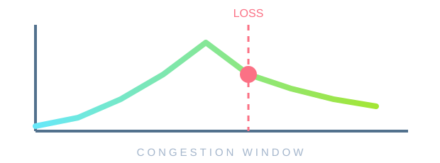

<p align="center">
  
  <br/>
  <br/>   
  <br/>
</p>

## 🧭 Overview

A deterministic teaching model of TCP congestion-window growth. Step through slow start and congestion avoidance, choose a loss round, and inspect how the simplified sender reacts.

## ✨ Features

- 📈 Live SVG chart of congestion-window size per round.
- 🎚️ Adjustable slow-start threshold and loss round.
- 🧠 Clear phase labels for slow start and congestion avoidance.
- 🔁 Reset and replay the same deterministic scenario.
- 🔒 All simulation runs locally in your browser.

## 🎬 Demo

Run the local app, change the loss round, and press **Next RTT**. The chart and event log update after each simulated round. This repository does not claim a hosted demo.

## 🚀 Quick Start

Requires Node.js 18 or newer.

```bash
npm start
```

Open http://localhost:4173.

## 🧰 Tech Stack

- 🟢 Node.js built-in HTTP server
- 🌐 HTML, CSS, browser JavaScript, and SVG
- 📦 No third-party dependencies

## 🗂️ Folder Structure

```text
tcp-congestion-playground/
├── assets/mark.svg
├── app.js
├── index.html
├── server.js
├── package.json
├── README.md
├── LICENSE
└── .gitignore
```

## 🛣️ Roadmap

- [ ] Add fast-recovery and timeout variants.
- [ ] Compare Reno and Cubic models.
- [ ] Export a simulation trace as CSV.

## 🤝 Contributing

Open an issue with a reproducible scenario or submit a focused pull request. Test locally with `npm start` and keep the model assumptions documented.

## 📄 License

MIT licensed. See [LICENSE](LICENSE).

<p align="center"></p>
